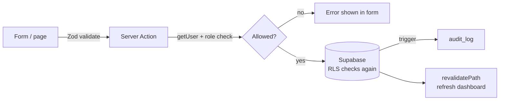

# CRUD Operations Reference

Every create, read, update and delete (CRUD) operation in the app: who can do it, how it's implemented, and the rules it must follow.

- **Implementation:** create, update and delete are Next.js **Server Actions** in `lib/actions/<entity>.ts`. Reads are typed queries in `lib/db/<entity>.ts`, run from Server Components. Every input is validated with Zod.
- **Enforcement:** permissions are checked by **Supabase Row Level Security (RLS)** and again in the action, so a check that's missing in the UI can't leak data.
- **Key:** O = Owner, S = Staff, — = not allowed. *Insert-only* means staff can create the record but can't read it back.
- **Delete policy:** financial and booking records are **cancelled or voided, not deleted**. Hard delete is owner-only, for records created by mistake (and recorded in `audit_log`).

---

## 1. Properties (apartments)

| Op | Action | Who | Rules |
|---|---|---|---|
| Create | `createProperty(data)` | O | Name unique; status `setup` by default; `max_guests` ≥ 1 |
| Read list | `listProperties({status})` | O, S | Staff see name, location, check-in/out times and status only |
| Read one | `getProperty(id)` | O, S | Owners also see base rate and this month's figures |
| Update | `updateProperty(id, data)` | O | Changing status to `inactive` is blocked while there are future confirmed bookings |
| Delete | `archiveProperty(id)` | O | Soft: status becomes `inactive`. Hard delete only if the apartment has no bookings or expenses |

## 2. Channels (Booking.com, Airbnb, Agoda, Direct, TripAdvisor, Other…)

| Op | Action | Who | Rules |
|---|---|---|---|
| Create | `createChannel(data)` | O | Name unique; `default_commission_pct` between 0 and 100; `payout_delay_days` ≥ 0 |
| Read | `listChannels({active})` | O, S | Staff don't see commission % |
| Update | `updateChannel(id, data)` | O | Changing the default commission doesn't change existing bookings |
| Delete | `deactivateChannel(id)` | O | Soft only (`active = false`) once any booking uses it |

## 3. Guests

| Op | Action | Who | Rules |
|---|---|---|---|
| Create | `createGuest(data)` | O, S | Name required; phone in E.164 format (+94…); warns if the phone or email is already on file |
| Read list | `searchGuests(q)` | O, S | Search by name, phone, email or country |
| Read one | `getGuest(id)` | O, S | Includes past stays; owners also see total spend |
| Update | `updateGuest(id, data)` | O, S | `extra_fields` checked against the custom field definitions |
| Delete | `deleteGuest(id)` | O | Only if the guest has no bookings; otherwise `anonymiseGuest(id)` (clears personal data, keeps the bookings) |
| Merge | `mergeGuests(keepId, dropId)` | O | Moves the bookings to one guest, then deletes the duplicate |

## 4. Guest identity (passport / NIC) — owner only

| Op | Action | Who | Rules |
|---|---|---|---|
| Create / Update | `upsertGuestIdentity(guestId, data, photo?)` | O | Photo goes to the private bucket `id-documents/`, max 5 MB, jpg/png/pdf |
| Read | `getGuestIdentity(guestId)` | O | Photo opened through a signed URL that expires in 60 s |
| Delete | `deleteGuestIdentity(guestId)` | O | Removes the row and the stored photo |

## 5. Bookings

| Op | Action | Who | Rules |
|---|---|---|---|
| Check | `checkAvailability(propertyId, checkIn, checkOut, excludeId?)` | O, S | Returns any clashing bookings |
| Create | `createBooking(data)` | O, S | One transaction: upsert guest → insert booking → insert finances → extras → deposit payment → expected payout. `check_out` after `check_in`; guests ≤ `max_guests`; the **overlap constraint** rejects clashing dates |
| Read list | `listBookings({propertyId, channelId, status, from, to, q})` | O, S | Paginated; staff rows come without money fields |
| Read calendar | `getCalendar(from, to)` | O, S | Confirmed and checked-in bookings, plus enquiry holds |
| Read one | `getBooking(id)` | O, S | Owners also get finances, payments, payout and extras |
| Update | `updateBooking(id, data)` | O, S | Date changes re-run the overlap check; `external_ref` stays unique per channel |
| Change status | `setBookingStatus(id, status, reason?)` | O, S | Only the transitions in the lifecycle diagram are allowed; `checked_out` creates a cleaning task |
| Cancel | `cancelBooking(id, {reason, refund?, fee?})` | O | Frees the dates; records a refund payment and/or a cancellation fee |
| Delete | `deleteBooking(id)` | O | Only for bookings entered by mistake that have no payments; logged |

## 6. Booking finances

| Op | Action | Who | Rules |
|---|---|---|---|
| Create | Inside `createBooking` | O, S (*insert-only*) | `currency` is LKR or USD; `fx_rate_usd_lkr` defaults to that day's rate; commission defaults from the channel |
| Read | `getBookingFinances(bookingId)` | O | — |
| Update | `updateBookingFinances(bookingId, data)` | O | Recalculates the net amount and `balance_due` |
| Delete | — | — | Removed only together with its booking |

## 7. Booking extras (pickup, tours, breakfast, extra guest…)

| Op | Action | Who | Rules |
|---|---|---|---|
| Create | `addExtra(bookingId, data)` | O, S | Amount ≥ 0 |
| Read | `listExtras(bookingId)` | O, S | Staff see the type, not the amount |
| Update | `updateExtra(id, data)` | O | — |
| Delete | `deleteExtra(id)` | O | Logged |

## 8. Payments (deposit, balance, extras, refunds)

| Op | Action | Who | Rules |
|---|---|---|---|
| Create | `recordPayment(bookingId, data)` | O, S (*insert-only*) | Amount > 0 (refunds are recorded as `kind = refund`); recalculates `payment_status` (`unpaid`, `deposit_paid`, `paid`, `refunded`) |
| Read | `listPayments({bookingId, from, to, method})` | O | — |
| Update | `updatePayment(id, data)` | O | Logged |
| Delete | `voidPayment(id, reason)` | O | Soft: `voided = true`; no longer counted in totals |

## 9. Payouts (money from Booking.com, Airbnb, Agoda)

| Op | Action | Who | Rules |
|---|---|---|---|
| Create | Auto in `createBooking` for platform channels | System | `expected_on` = check-in + the channel's `payout_delay_days` |
| Read | `listPayouts({status: pending, late, received})` | O | Late = `expected_on` has passed and nothing received |
| Update | `markPayoutReceived(id, {receivedOn, amount, currency, reference})` | O | Flags a difference if the amount received isn't the expected net |
| Delete | — | — | Removed only together with its booking |

## 10. Expense categories

| Op | Action | Who | Rules |
|---|---|---|---|
| Create | `createCategory(name)` | O | Name unique |
| Read | `listCategories()` | O, S | — |
| Update | `renameCategory(id, name)` | O | — |
| Delete | `deactivateCategory(id)` | O | Soft once any expense uses it |

## 11. Expenses

| Op | Action | Who | Rules |
|---|---|---|---|
| Create | `createExpense(data, receipt?)` | O, S | Amount > 0; `property_id` empty means a shared cost; receipt goes to `receipts/` (max 5 MB) |
| Create recurring | `createRecurringExpense(template)` | O | Salaries, internet and similar; the cron job creates each month's entry |
| Read list | `listExpenses({propertyId, categoryId, from, to})` | O all, S own | Totals by category and apartment |
| Read one | `getExpense(id)` | O, S own | Receipt opened through a signed URL |
| Update | `updateExpense(id, data)` | O, S own within 7 days | Logged |
| Delete | `deleteExpense(id)` | O | Logged; the receipt file is removed |

## 12. Cleaning tasks

| Op | Action | Who | Rules |
|---|---|---|---|
| Create | Auto (DB trigger on `checked_out`), or `createCleaningTask(data)` | System, O, S | One automatic task per booking |
| Read | `listCleaningTasks({date, propertyId, assignedTo, status})` | O, S | Staff default view: "My tasks today" |
| Update | `updateCleaningTask(id, {assignedTo, dueOn, notes})` | O, S | — |
| Complete | `completeCleaningTask(id, {suppliesUsed?})` | O, S | Records `completed_at`; supplies used become inventory movements |
| Delete | `deleteCleaningTask(id)` | O | — |

## 13. Maintenance issues

| Op | Action | Who | Rules |
|---|---|---|---|
| Create | `reportIssue(data, photo?)` | O, S | Title and apartment required; priority `low`, `medium` or `urgent` |
| Read | `listIssues({propertyId, status, priority})` | O, S | Cost hidden from staff |
| Update | `updateIssue(id, data)` | O, S | Staff can change the status and notes |
| Resolve | `resolveIssue(id, {fixedOn, cost?, createExpense?})` | O | Can create the matching expense automatically |
| Delete | `deleteIssue(id)` | O | — |

## 14. Inventory items and movements

| Op | Action | Who | Rules |
|---|---|---|---|
| Create item | `createItem(data)` | O, S | Name unique per apartment; `low_stock_level` ≥ 0 |
| Read items | `listItems({propertyId, lowStockOnly})` | O, S | — |
| Update item | `updateItem(id, data)` | O, S | Quantity can't be edited directly; it changes only through movements |
| Delete item | `deleteItem(id)` | O | Soft if the item has any movements |
| Create movement | `recordMovement(itemId, {change, reason})` | O, S | Updates `quantity` in the same transaction; quantity can't go below 0 |
| Read movements | `listMovements(itemId)` | O, S | — |
| Update / Delete movement | `reverseMovement(id)` | O | Adds an opposite movement instead of editing the original |

## 15. Users (profiles)

| Op | Action | Who | Rules |
|---|---|---|---|
| Create | `inviteUser(email, role)` | O | Supabase Auth invite email; role is `owner` or `staff` |
| Read | `listUsers()` | O | — |
| Update | `updateUser(id, {role, fullName, phone, active})` | O | The last active owner can't be demoted or deactivated |
| Delete | `deactivateUser(id)` | O | Soft; the user can't log in, but their history is kept |
| Self | `updateMyProfile(data)` | O, S | Own name and phone only |

## 16. Custom guest fields

| Op | Action | Who | Rules |
|---|---|---|---|
| Create | `createGuestField({key, label, type, required})` | O | Type is `text`, `number`, `date`, `select` or `boolean` |
| Read | `listGuestFields()` | O, S | Used to build the guest form |
| Update | `updateGuestField(id, data)` | O | The key can't change after use |
| Delete | `deleteGuestField(id)` | O | Hidden from forms; existing values are kept in `extra_fields` |

## 17. Exchange rates and settings

| Op | Action | Who | Rules |
|---|---|---|---|
| Create | Cron `saveDailyRate()` or `setRate(date, usdLkr)` | System, O | One rate per date |
| Read | `getRate(date)` | O, S | Falls back to the most recent earlier date |
| Update | `setRate(date, usdLkr)` | O | Doesn't change the rate already stored on existing records |
| Settings | `getSettings()` / `updateSettings(data)` | O | Reminder email list, cron time, the property used for shared costs, revenue counting basis |

## 18. Read-only views and reports (owner only)

| View | Action | Returns |
|---|---|---|
| `v_today` | `getToday()` | Arrivals, departures, tasks, items needing attention (money removed for staff) |
| `v_booking_nights` | (internal) | One row per booked night, with its share of the revenue |
| `v_monthly_pnl` | `getPnL({from, to, propertyId?})` | Income, commission, extras, expenses, profit, in LKR and USD |
| `v_channel_stats` | `getChannelStats({from, to})` | Bookings, nights, gross, commission, net, average nightly rate, cancellation % |
| `v_occupancy` | `getOccupancy({from, to, propertyId?})` | Occupancy %, average daily rate, revenue per available night |
| Export | `exportCsv(report, filters)` | CSV download |

## 19. Reminder log (system)

| Op | Action | Who | Rules |
|---|---|---|---|
| Create | Cron job only (service role) | System | At most one reminder per booking, type and day |
| Read | `listReminders({bookingId})` | O | Shown in the booking's history |
| Update / Delete | — | — | Not allowed |

---

## RLS policy summary

| Table | select | insert | update | delete |
|---|---|---|---|---|
| properties, channels, expense_categories, guest_fields | all signed-in users | owner | owner | owner |
| guests, bookings, booking_extras | all signed-in users | all signed-in users | all signed-in users | owner |
| booking_finances, payments | owner | all signed-in users | owner | owner |
| guest_identity, payouts, exchange_rates (write), app_settings, reminder_log | owner | owner / service | owner / service | owner |
| expenses | owner, or `created_by = auth.uid()` | all signed-in users | owner, or own within 7 days | owner |
| cleaning_tasks, maintenance_issues, inventory_items, inventory_movements | all signed-in users | all signed-in users | all signed-in users | owner |
| profiles | owner, or own row | via invite (service) | owner, or own row (not role) | — |
| audit_log | owner | trigger only | — | — |

Helper used in policies: `public.is_owner()` → `exists (select 1 from profiles where id = auth.uid() and role = 'owner' and active)`.
