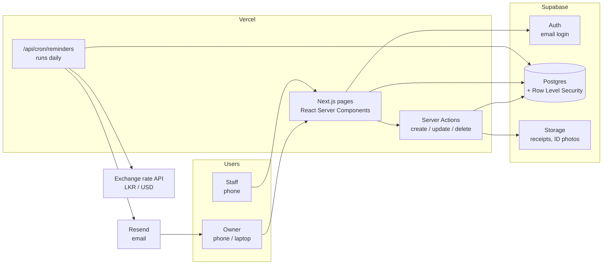
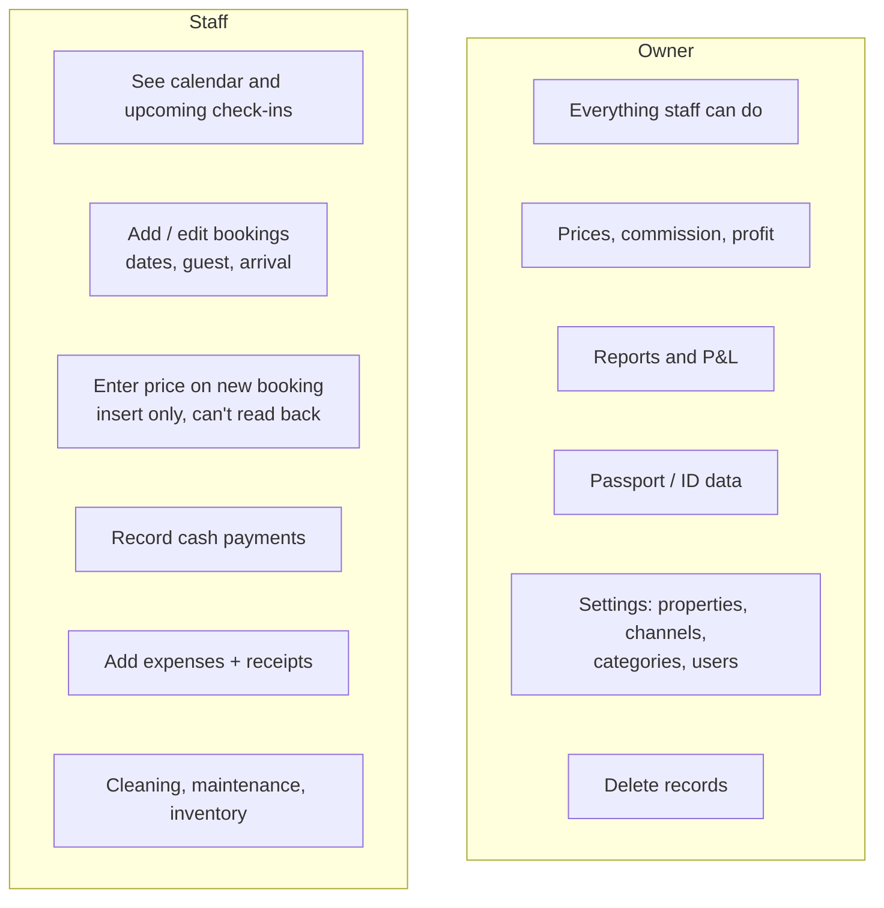
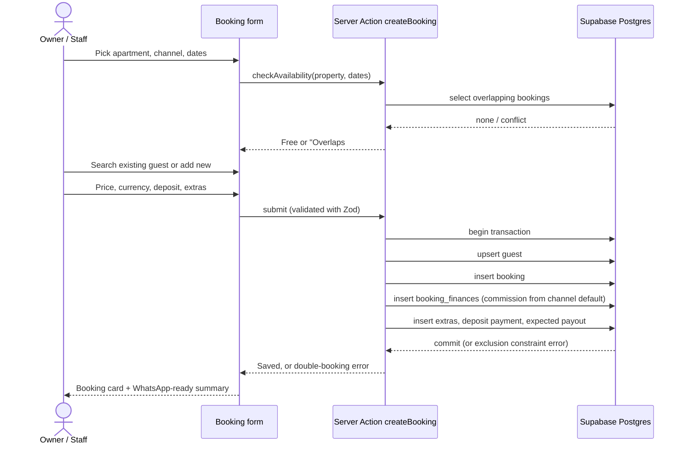
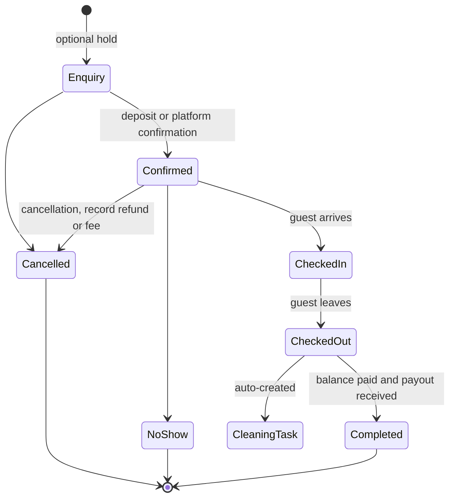
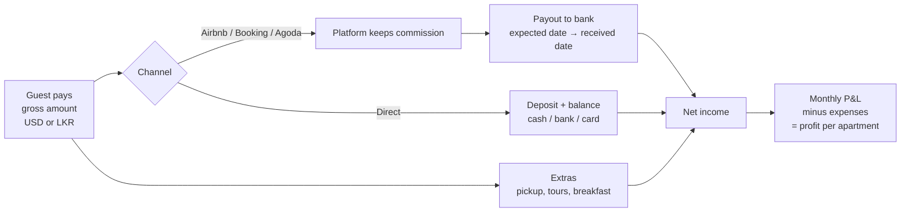
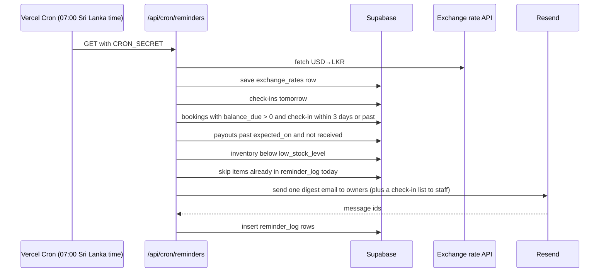
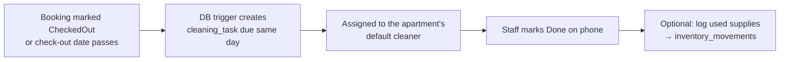
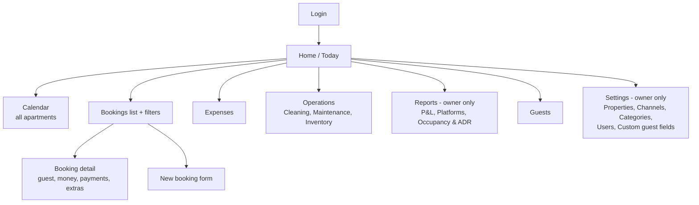
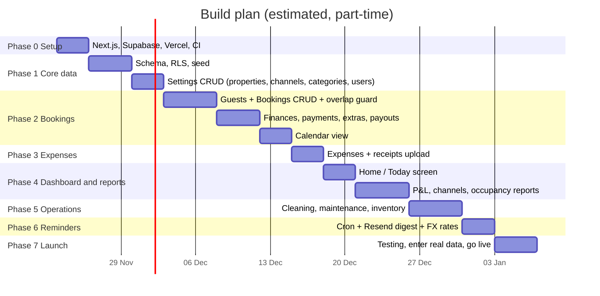

# Implementation Plan – Holiday Apartment Booking & Finance Dashboard

_Status: planning, no code written yet. Last updated 2026-11-19._

Related documents:
- [REQUIREMENTS.md](REQUIREMENTS.md): what the owners asked for
- [CRUD_OPERATIONS.md](CRUD_OPERATIONS.md): every create, read, update and delete operation, with who is allowed to do it

---

## 1. Summary

A mobile-friendly web app for running 5 holiday apartments in Sri Lanka (2 are operating today). It keeps every booking from Booking.com, Airbnb, Agoda, direct bookings (WhatsApp or phone) and any other channel in one place. It tracks money in LKR and USD, blocks double bookings, handles cleaning, maintenance and stock, and emails reminders through Resend.

| Item | Choice |
|---|---|
| Frontend + server | Next.js (App Router, Server Actions, TypeScript) |
| UI | Tailwind CSS + shadcn/ui, charts with Recharts |
| Database, login, files | Supabase (Postgres, Auth, Row Level Security, Storage) |
| Email | Resend + React Email templates |
| Scheduled jobs | Vercel Cron, calling a protected API route every day |
| Hosting | Vercel (free tier to start) |
| Validation | Zod (the same schemas are used in forms and on the server) |

---

## 2. System architecture



**Key principles**
- **Security lives in the database.** Row Level Security policies decide what owners and staff can see, so a bug in the UI can't leak profit figures or passport data.
- **Money is stored in its original currency** together with the exchange rate used, and is converted for display. Totals never change after the fact.
- **Booking channels, expense categories and custom guest fields are data, not code.** New platforms (e.g. TripAdvisor) or apartments are added from the Settings screen.
- **Built for imports later.** Every booking stores its `source` (`manual`, `csv`, `ical`, `channel_manager`) and an `external_ref`, so automatic sync can be added without changing the schema.

---

## 3. Data model

### 3.1 Entity relationship diagram

```mermaid
erDiagram
    PROFILES ||--o{ BOOKINGS : "created_by"
    PROPERTIES ||--o{ BOOKINGS : has
    CHANNELS ||--o{ BOOKINGS : "booked via"
    GUESTS ||--o{ BOOKINGS : makes
    GUESTS ||--o| GUEST_IDENTITY : "has (owner only)"
    BOOKINGS ||--|| BOOKING_FINANCES : "money (owner only)"
    BOOKINGS ||--o{ BOOKING_EXTRAS : includes
    BOOKINGS ||--o{ PAYMENTS : receives
    BOOKINGS ||--o| PAYOUTS : "paid out by channel"
    BOOKINGS ||--o| CLEANING_TASKS : "triggers after checkout"
    PROPERTIES ||--o{ EXPENSES : incurs
    EXPENSE_CATEGORIES ||--o{ EXPENSES : classifies
    PROPERTIES ||--o{ CLEANING_TASKS : has
    PROFILES ||--o{ CLEANING_TASKS : "assigned to"
    PROPERTIES ||--o{ MAINTENANCE_ISSUES : has
    PROPERTIES ||--o{ INVENTORY_ITEMS : stocks
    INVENTORY_ITEMS ||--o{ INVENTORY_MOVEMENTS : logs
    BOOKINGS ||--o{ REMINDER_LOG : "reminded about"

    PROFILES {
        uuid id PK
        text full_name
        text role "owner or staff"
        text phone
        bool active
    }
    PROPERTIES {
        uuid id PK
        text name
        text location "Kandy, Nuwara Eliya, South..."
        text status "operating, setup, inactive"
        int max_guests
        time default_checkin_time
        time default_checkout_time
        numeric base_rate_lkr
    }
    CHANNELS {
        uuid id PK
        text name "Booking.com, Airbnb, Agoda, Direct..."
        numeric default_commission_pct
        int payout_delay_days
        bool active
    }
    GUESTS {
        uuid id PK
        text full_name
        text phone
        text email
        text country
        jsonb extra_fields
        text notes
    }
    GUEST_IDENTITY {
        uuid guest_id PK
        text id_type "passport or NIC"
        text id_number
        text id_photo_path
    }
    BOOKINGS {
        uuid id PK
        uuid property_id FK
        uuid channel_id FK
        uuid guest_id FK
        text external_ref
        text source "manual, csv, ical"
        text status
        date check_in
        date check_out
        int adults
        int children
        time expected_arrival
        bool pickup_needed
        text special_requests
    }
    BOOKING_FINANCES {
        uuid booking_id PK
        text currency "LKR or USD"
        numeric gross_amount
        numeric commission_amount
        numeric fx_rate_usd_lkr
        numeric deposit_due
        numeric balance_due
        text payment_status
    }
    BOOKING_EXTRAS {
        uuid id PK
        uuid booking_id FK
        text type "pickup, tour, breakfast..."
        numeric amount
        text currency
    }
    PAYMENTS {
        uuid id PK
        uuid booking_id FK
        text kind "deposit, balance, extra, refund"
        numeric amount
        text currency
        text method "cash, card, bank, platform"
        date paid_on
        uuid recorded_by FK
    }
    PAYOUTS {
        uuid id PK
        uuid booking_id FK
        date expected_on
        date received_on
        numeric amount_received
        text currency
        text reference
    }
    EXPENSE_CATEGORIES {
        uuid id PK
        text name
        bool active
    }
    EXPENSES {
        uuid id PK
        uuid property_id FK "null = shared"
        uuid category_id FK
        date spent_on
        numeric amount
        text currency
        numeric fx_rate_usd_lkr
        text note
        text receipt_path
        uuid created_by FK
    }
    CLEANING_TASKS {
        uuid id PK
        uuid property_id FK
        uuid booking_id FK
        uuid assigned_to FK
        date due_on
        text status "todo, in_progress, done"
        timestamptz completed_at
    }
    MAINTENANCE_ISSUES {
        uuid id PK
        uuid property_id FK
        text title
        text priority
        text status "open, in_progress, fixed"
        date reported_on
        date fixed_on
        numeric cost_lkr
        uuid expense_id FK
    }
    INVENTORY_ITEMS {
        uuid id PK
        uuid property_id FK
        text name
        text unit
        numeric quantity
        numeric low_stock_level
    }
    INVENTORY_MOVEMENTS {
        uuid id PK
        uuid item_id FK
        numeric change
        text reason "restock, used, damaged, count"
        uuid created_by FK
    }
    REMINDER_LOG {
        uuid id PK
        uuid booking_id FK
        text type "checkin, unpaid, payout"
        timestamptz sent_at
        text resend_id
    }
```



Other tables not shown: `exchange_rates (date, usd_lkr)`, `app_settings (key, value)`, `audit_log (table, row_id, action, user_id, at, diff)`.

### 3.2 Why money and ID data live in separate tables

Postgres Row Level Security works on **rows, not columns**. Staff need to see bookings (dates, guest name, arrival time) but must not see the price, profit or passport. So:

- `bookings` holds what staff can see.
- `booking_finances` holds the price, commission, deposit and balance. Staff can **insert** a row (when they enter a WhatsApp booking with a price) but can't **select** it. Owners can do everything.
- `guest_identity` holds passport and ID details and is owner-only. ID photos go in a private Storage bucket.
- `payments`: staff can record cash collected at check-in (insert only) and can't list past payments.

### 3.3 Double-booking protection

This is enforced in the database, so it holds even if two people save bookings at the same moment:

```sql
create extension if not exists btree_gist;

alter table bookings add constraint no_overlapping_bookings
  exclude using gist (
    property_id with =,
    daterange(check_in, check_out, '[)') with &&
  ) where (status in ('confirmed', 'checked_in'));
```

`'[)'` means the check-out day is free, so one guest can check out and the next check in on the same day. The server action catches the constraint error and shows: *"Overlaps booking #1234 (Airbnb, 12–15 Dec). Not saved."*

### 3.4 Currency

- Each amount is stored as `amount + currency + fx_rate_usd_lkr` (the rate on the booking or expense date).
- Every day the cron job saves that day's rate in `exchange_rates`. Owners can override the rate on any record, for example to match what the bank actually paid.
- Reports show **LKR | USD** columns side by side.

---

## 4. Roles and permissions



| Area | Owner | Staff |
|---|---|---|
| Bookings: dates, guest, notes | Create, read, update, cancel | Create, read, update |
| Booking money | Full | Insert only on create |
| Guest passport / ID | Full | None |
| Payments | Full | Insert only |
| Payouts | Full | None |
| Expenses | Full | Create; read and edit their own |
| Cleaning / maintenance / inventory | Full | Full except delete |
| Reports, dashboard money cards | Yes | Hidden |
| Settings and users | Yes | No |

Full detail for each operation: [CRUD_OPERATIONS.md](CRUD_OPERATIONS.md).

---

## 5. Key flows

### 5.1 Adding a booking (e.g. a WhatsApp enquiry on the phone)



### 5.2 Booking lifecycle



Only `Confirmed` and `CheckedIn` bookings block dates. `Enquiry` shows on the calendar as a soft hold.

### 5.3 Money flow for one booking



### 5.4 Daily reminders job



One **daily digest** email instead of many single emails keeps inboxes clean and stays within Resend's free tier.

### 5.5 Check-out to cleaning



---

## 6. Screens



**Home / Today (phone layout, top to bottom)**
1. Today's arrivals and departures, with guest, apartment, arrival time, pickup and balance to collect
2. Next 7 days of check-ins
3. Needs attention: unpaid balances, late payouts, low stock, open maintenance
4. Today's cleaning tasks
5. *(owner only)* This month: income, expenses, profit, occupancy for each apartment, in LKR and USD
6. Calendar strip

---

## 7. Reports (owner only)

| Report | Calculation |
|---|---|
| **Monthly P&L** | Net booking income (gross − commission + extras − refunds) − expenses, per apartment and in total, LKR and USD. Shared expenses can be split evenly across operating apartments or shown separately. |
| **Platform comparison** | For each channel: bookings, nights, gross, commission paid, net, average nightly rate, cancellation rate |
| **Occupancy** | booked nights ÷ available nights, per apartment, month and season |
| **ADR** (average daily rate) | room revenue ÷ booked nights |
| **RevPAR** (revenue per available night) | room revenue ÷ available nights |

Revenue is counted on the **stay date**: a stay from 30 Nov to 3 Dec puts 1 night in November and 2 in December. The calculations live in Postgres views (`v_booking_nights`, `v_monthly_pnl`, `v_channel_stats`) so the numbers stay the same everywhere they appear.

---

## 8. Project structure

```
property-finance-dashboard/
├── app/
│   ├── (auth)/login/
│   ├── (app)/
│   │   ├── page.tsx                 # Home / Today
│   │   ├── calendar/
│   │   ├── bookings/ [id]/ new/
│   │   ├── guests/ [id]/
│   │   ├── expenses/ new/
│   │   ├── operations/ cleaning/ maintenance/ inventory/
│   │   ├── reports/ pnl/ channels/ occupancy/
│   │   └── settings/ properties/ channels/ categories/ users/ fields/
│   └── api/cron/reminders/route.ts
├── lib/
│   ├── actions/                     # Server Actions, one file per entity
│   ├── db/                          # typed queries, generated Supabase types
│   ├── validation/                  # Zod schemas
│   ├── money.ts                     # currency + FX helpers
│   └── email/                       # React Email templates
├── supabase/
│   ├── migrations/                  # SQL: tables, RLS, constraints, views, triggers
│   └── seed.sql                     # sample apartments, channels, categories
├── docs/
└── tests/                           # Vitest (unit) + Playwright (end to end)
```

---

## 9. Implementation phases



### Phase 0: Setup
- Create the Next.js app (TypeScript, Tailwind, shadcn/ui, ESLint, Prettier)
- Create a Supabase project, link the CLI, start migrations
- Deploy to Vercel, add environment variables (`SUPABASE_URL`, `SUPABASE_ANON_KEY`, `SUPABASE_SERVICE_ROLE_KEY`, `RESEND_API_KEY`, `CRON_SECRET`)
- GitHub Actions: lint, type-check and tests on every push
- **Done when:** an empty app is live on a Vercel URL with login working

### Phase 1: Core data and settings
- Migrations for every table in section 3, the RLS policies, the double-booking constraint and the audit triggers
- Seed: the 5 apartments (2 operating, 3 in setup), the channels (Booking.com 15%, Airbnb ~3–15%, Agoda 15–18%, Direct 0%, TripAdvisor, Other), the expense categories
- Settings screens: Properties, Channels, Expense categories, Users (invite staff, set role), Custom guest fields
- **Done when:** an owner can invite a staff member, and the staff login can't open Settings

### Phase 2: Bookings
- Guests: search, create, edit; ID section visible to owners only
- Booking form for phone and desktop, with live availability check and channel default commission
- Booking detail: status changes, payments, extras, payout tracking, a WhatsApp summary to copy
- Calendar: month and week view across all apartments, colour-coded by channel
- **Done when:** a double booking is impossible, and staff can add a booking but never see its price afterwards

### Phase 3: Expenses
- Fast expense entry on the phone (amount, category, apartment, photo of the receipt)
- Filters by month, apartment and category; recurring expenses (salaries, internet) as templates
- **Done when:** a whole month of real expenses can be entered and totals match the paper records

### Phase 4: Dashboard and reports
- Home / Today screen (section 6)
- Postgres views and report pages, with CSV download of each table
- **Done when:** the P&L for a test month matches a hand calculation in a spreadsheet

### Phase 5: Operations
- Automatic cleaning tasks (DB trigger), assignment and a staff checklist view
- Maintenance log, with an option to turn a repair cost into an expense
- Inventory with stock movements and low-stock flags

### Phase 6: Reminders
- `/api/cron/reminders` protected by `CRON_SECRET`, run daily by Vercel Cron
- Resend domain verification, React Email digest template
- Daily exchange rate fetch

### Phase 7: Launch
- Enter the current and future bookings for the 2 operating apartments
- A week of running the dashboard alongside the current method, then switch over
- Back-ups: Supabase daily back-ups plus a monthly CSV export

### Later (not in v1)
- iCal import from each platform, to block dates automatically
- CSV import of payout reports
- Connection to a channel manager (Beds24, Hostaway and similar)
- Accountant or tax export
- Guest messaging templates

---

## 10. Testing

| Level | What |
|---|---|
| Database (pgTAP or SQL tests) | RLS: staff can't select `booking_finances`, `guest_identity`, `payouts`; the overlap constraint rejects clashing bookings; same-day turnover is allowed |
| Unit (Vitest) | Money and FX helpers, splitting nights across months, commission calculation, Zod schemas |
| End to end (Playwright) | Owner creates a booking → staff sees it without the price → checkout → cleaning task appears → report totals update |
| Manual | Phone check of the booking form and Home screen on a real Android/iPhone |

---

## 11. Security and privacy

- Passport and ID numbers are owner-only, ID photos sit in a private bucket and are opened with short-lived signed URLs.
- The service-role key is used **only** by the server-side cron job, never sent to the browser.
- An audit log records who created, changed or deleted bookings, payments and expenses.
- Real guest data never goes into the git repo (see `.gitignore`); `seed.sql` uses made-up data only.
- Bookings and payments are **cancelled or voided, not deleted**, so the financial history stays complete.

---

## 12. Open questions for the owners

1. Names and exact locations of the 5 apartments, and which 2 are operating?
2. Should shared costs (e.g. a manager's salary) be split across apartments in the P&L, or shown separately?
3. Should revenue be counted on stay dates (recommended) or on payment dates?
4. Who should receive the daily email: all owners only, or staff too (check-in list only)?
5. Do any staff work at only one apartment, so they should see only that apartment?
